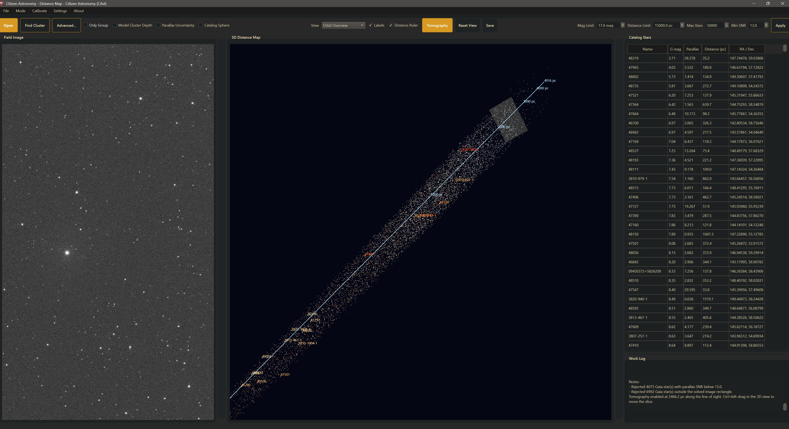

# Distance Map

## Introduction

A star field in an image is flat. Two stars that sit side by side on the sensor can be ten parsecs or ten thousand parsecs away from each other along the line of sight.

**Distance Map** takes one solved sky image, queries Gaia DR3 for the stars inside that footprint, converts their parallaxes to distances, and draws the field as a 3D point cloud with you (the observer) at the origin. You can orbit the cloud, slice through it with your own image, measure depth with a ruler, and search for groups of stars that move together through space.

This mode is a field-scale visualization and exploration aid built on Gaia astrometry. It is not a full physical model of the Milky Way, and its cluster search is not a membership study.

### What you can do with this mode

- **Build a 3D map from a single image field.** Open a solved (or solvable) frame and CAst queries Gaia stars inside that footprint.
- **Filter the catalog.** Limit stars by G magnitude (**Mag Limit**), distance (**Distance Limit**), parallax quality (**Min SNR**), and count (**Max Stars**).
- **Inspect the field in 3D.** Orbit, pan, and zoom with the mouse, or pick **Orbit Overview**, **Top-Down**, **Side View**, **Field Center**, or **Tomography Face-On** from **View**.
- **Slice through the volume.** **Tomography** places your field image as a translucent plane in the 3D view; **Ctrl+left-drag** moves it in depth.
- **Search for co-moving groups.** **Find Cluster** and **Advanced...** highlight a likely open-cluster or moving-group population from Gaia proper motion and parallax.
- **Follow the group across views.** Highlighted members are emphasized in the 3D map, colored in the **Catalog Stars** table, and marked on the **Field Image**. **Only Group** filters all three.
- **Show depth confidence.** **Parallax Uncertainty** draws each star's distance interval along its line of sight; **Distance Ruler** adds a parsec scale.
- **Compare with a bundled globular cluster catalog.** **Catalog Sphere** overlays a distance and radius sphere for 17 named globular clusters.
- **Save a figure.** **Save** exports the current 3D view as PNG, JPEG, or BMP.

### Why this matters

Many images mix stars that only appear close together because they land in the same line of sight. Gaia measured parallaxes and proper motions for more than a billion stars. Distance Map brings that third dimension into CAst, so you can see how the stars in your frame are spread out in depth and whether part of the field moves as one group.

---

## How It Works

### Step 1: Open the mode

Use one of these:

- On the mode picker, click the **Distance Map** card ("Map catalog stars in 3D using their measured distances.").
- From any mode, choose **Mode > Distance Map**.
- Choose **Mode > Choose Mode...** to return to the mode picker.

### Step 2: Open a source image

Click **Open** on the mode toolbar, or choose **File > Open File** (**Ctrl+O**). The file picker title is:

`Select source image for Distance Map`

Supported inputs:

- `.xisf`
- `.fits` / `.fit`
- `.tif` / `.tiff`
- `.png`
- `.jpg` / `.jpeg`
- camera RAW (for example `.dng`, `.cr2` / `.cr3`, `.nef`, `.arw`, `.orf`, `.rw2`, `.raf`, `.pef`)

The mode uses one image at a time. If the file is missing CAst shows **Image not found**; if the extension is not supported it shows **Unsupported image**.

### Step 3: Let the build run

As soon as you choose a file, Distance Map restores your saved limits and starts a background build. While it runs:

- **Open** changes to **Building...** and is disabled.
- **Apply**, the limit fields, **View**, **Labels**, **Distance Ruler**, **Reset View**, and **Save** are disabled.
- The **Work Log** and the status bar report each step.

The build:

1. Checks the image WCS. If the embedded WCS is missing or unusable, CAst recovers a plate solution. It runs metadata-seeded Gaia matching and, when an **Astrometry API Key** is set under **Settings > Open Settings > General**, astrometry.net at the same time, and keeps whichever succeeds first. The log notes `Plate-solved the image with astrometry.net before querying catalogs.` when a solve was needed.
2. Queries Gaia DR3 for stars with G at or below **Mag Limit** inside the solved field.
3. Rejects stars below **Min SNR**, stars without a positive parallax, stars beyond **Distance Limit**, and stars outside the image rectangle.
4. Keeps the brightest **Max Stars** survivors and draws them.

When the build finishes, the status bar reads `Distance Map drew N star(s) from M Gaia source(s).` If it fails, a **Distance Map failed** message box explains why.

The main panels, left to right, are:

- **Field Image**
- **3D Distance Map**
- **Catalog Stars** (top right)
- **Work Log** (bottom right)

Drag the splitters between them to resize.

### Step 4: Look around the 3D field

The default camera is **Orbit Overview**. Use the mouse in the 3D view:

| Action | Result |
|--------|--------|
| Left-drag | Orbit around the current center |
| Ctrl + left-drag | Pan in the view plane (moves the slice instead when **Tomography** is on) |
| Middle-drag | Pan |
| Ctrl + middle-drag | Pan sideways and forward or back instead of up and down |
| Mouse wheel | Zoom in or out |
| Ctrl + mouse wheel | Change the field of view |
| Arrow keys | Orbit (click the 3D view first so it has focus) |

Pick a preset camera from **View**:

- **Orbit Overview**: angled view of the whole cloud
- **Top-Down**: looking straight down on the cloud
- **Side View**: low, side-on view
- **Field Center**: closer view centered on the stars
- **Tomography Face-On**: looks at the Tomography slice face-on (only meaningful while **Tomography** is on)

The camera centers on the mean position of the visible stars, or on the highlighted group when one exists. Click **Reset View** to return to the selected **View** preset.

In the **Field Image**, scroll to zoom and left-drag to pan.

### Step 5: Adjust the limits

The right end of the toolbar holds:

- **Mag Limit**
- **Distance Limit**
- **Max Stars**
- **Min SNR**
- **Apply**

Change any value and click **Apply** to re-query Gaia and rebuild the map. Defaults and ranges are in [Controls and Defaults](#controls-and-defaults). Values are saved and restored the next time you open an image.

### Step 6: Find a cluster

Click **Find Cluster** to search the current map for a likely open-cluster or moving-group population using Gaia proper motions and, when enough stars have it, parallax.

To change the search first, click **Advanced...**, pick a preset or expert options, and click **OK**. The next **Find Cluster** uses the new settings.

After a successful detection:

- members are drawn larger with a gold glow in 3D
- matching rows in **Catalog Stars** turn gold
- members are circled on the **Field Image** in their BP-RP color (names are shown when there are six or fewer)
- **Labels** shows member names instead of field-star names
- the **Work Log** records how many members were found, the preset, the backend, and whether parallax was used
- **Find Cluster** changes to **Find All**

Turn on **Only Group** to hide every non-member in the 3D map and the table. Click **Find All** to clear the group and return to the full selection.

If no group is found, CAst reports:

`Could not identify a likely cluster from the current map stars. Try loosening the preset or increasing the star count.`

### Step 7: Use the display tools

Turn on any of **Labels**, **Distance Ruler**, **Parallax Uncertainty**, **Catalog Sphere**, and **Model Cluster Depth**, or click **Tomography**. Each is described in [Reading the Visualization](#reading-the-visualization).

### Step 8: Save the view

Click **Save** to export the current 3D view. See [Saving Output](#saving-output).

---

## Input Requirements

| Requirement | Why |
|-------------|-----|
| A solved image, or one CAst can solve | Gaia stars must be matched to a real sky footprint |
| Network access | The Gaia query comes from external catalog services |
| Stars with positive Gaia parallax | Needed to turn stars into distances |
| OpenGL-capable environment | Required for the 3D view |

If OpenGL is unavailable, the 3D panel reports:

`OpenGL 3D view is unavailable in this environment.`

After a build in that case it reads `N star(s) loaded, but OpenGL 3D view is unavailable.` The table and log still fill in.

---

## Controls and Defaults

### Limits (toolbar, need Apply)

| Control | Default | Range | Notes |
|---------|---------|-------|-------|
| **Mag Limit** | 17.0 mag | 1.0 to 22.0, step 0.5 | Gaia G magnitude cut sent with the query |
| **Distance Limit** | 500.0 pc | 1.0 to 50000.0, step 50 | Stars farther than this (from 1000 / parallax) are rejected |
| **Max Stars** | 500 | 10 to 50000, step 50 | Stars drawn after filtering. Gaia is queried for up to 4 x this many rows (at least 500) |
| **Min SNR** | 5.0 | 0.0 to 50.0, step 0.5 | Parallax / parallax error must be at or above this. 0 disables the cut |

These four values are saved in your settings.

### Display (toolbar, instant)

| Control | Default | Saved |
|---------|---------|-------|
| **View** | Orbit Overview | No |
| **Labels** | On | No |
| **Distance Ruler** | Off | No |
| **Tomography** | Off | No |
| **Only Group** | Off (enabled once a group exists) | No |
| **Model Cluster Depth** | On | Yes |
| **Parallax Uncertainty** | Off | Yes |
| **Catalog Sphere** | Off | Yes |

**Find Cluster**, **Tomography**, **Distance Ruler**, **Model Cluster Depth**, **Parallax Uncertainty**, and **Catalog Sphere** are disabled until a map with stars exists.

### Cluster detection (Advanced..., saved)

| Setting | Default |
|---------|---------|
| **Preset** | Default |
| **Turn on Only Group automatically after detection** | Off |
| **Backend** | Auto (recommended) |
| **Strictness** | 1.00 (range 0.40 to 2.50) |
| **Parallax** | Auto |
| **Apply magnitude/color cleanup** | On |

---

## The Distance Pipeline

### 1. Resolve the field

Distance Map validates the embedded WCS first. If it is unusable, CAst uses the same solver as Sky Explorer: metadata-seeded Gaia matching and, with an astrometry.net key, astrometry.net in parallel. Solutions are cached under the Sky Explorer WCS cache.

### 2. Query Gaia DR3

Using the solved footprint, CAst queries Gaia DR3 for stars at or below **Mag Limit**. The row cap is

$$
\text{rows} = \max(4 \times \text{Max Stars},\ 500)
$$

so later filtering still leaves enough stars. Results are cached under `distance-map-catalogs` in the cache directory.

Each star carries:

- name or identifier
- G magnitude
- BP-RP color when available
- parallax and parallax error
- proper motion in RA and Dec
- RA / Dec

### 3. Filter

Each Gaia row passes through these cuts in order:

1. **Parallax SNR**: \(\varpi / \sigma_\varpi \ge\) **Min SNR** (skipped when **Min SNR** is 0). Stars without a positive parallax and error fail.
2. **Usable parallax and distance**: the parallax must be positive and the derived distance at or below **Distance Limit**.
3. **Image footprint**: the star must land inside the solved image rectangle, not just the query cone.

The **Work Log** reports how many stars each cut rejected.

### 4. Convert parallax into distance

$$
d_{pc} = \frac{1000}{\varpi_{mas}}
$$

where \(\varpi\) is parallax in milliarcseconds. This simple inversion is reasonable when the parallax is much larger than its error, which is why **Min SNR** defaults to 5.

### 5. Build 3D coordinates

RA, Dec, and distance are converted to ICRS Cartesian coordinates in parsecs. The observer sits at the origin, drawn as a small cyan point.

### 6. Sort and cap

Survivors are sorted by G magnitude (brightest first), then distance, and the first **Max Stars** are kept. The **Catalog Stars** table uses the same order.

---

## Reading the Visualization

### Stars

- Color follows Gaia **BP-RP**, from blue (about -0.4) through white and orange to red (about 3.0). Stars without BP-RP are green.
- Point size follows G magnitude: brighter stars are larger (2 to 10 pixels).
- Highlighted group members are drawn at least 7 pixels with a gold glow.

### Labels

**Labels** (on by default) shows up to 40 names. With a group highlighted it labels members; otherwise it labels the first 40 stars, which are the brightest.

### Distance Ruler

**Distance Ruler** draws a line along the image's line of sight, offset slightly to the side, spanning the nearest to farthest visible star, with up to seven parsec ticks.

### Parallax Uncertainty

**Parallax Uncertainty** draws a line for each star from

$$
d_{near} = \frac{1000}{\varpi + \sigma_\varpi} \quad \text{to} \quad d_{far} = \frac{1000}{\varpi - \sigma_\varpi}
$$

along its line of sight. Long lines mean the depth is poorly constrained. When a group exists, only members get lines. At most 2500 lines are drawn (brightest first).

### Catalog Sphere

**Catalog Sphere** looks up the bundled globular cluster catalog: M3, M4, M5, M10, M12, M13, M14, M15, M19, M22, M28, M53, M62, M79, M92, 47 Tuc, and Omega Cen. It matches the cluster nearest the field (or the highlighted group's mean position), or one with at least five map stars inside its visible core, and draws a gold wireframe sphere at the catalog distance. The sphere marks the visible core, not the full catalog radius. The **Work Log** reports the match, or `No named globular cluster matched the current field for catalog distances.`

Globular clusters lie thousands of parsecs away. Raise **Distance Limit**, and usually lower **Min SNR**, before expecting their stars in the map.

### Model Cluster Depth

**Model Cluster Depth** is on by default. When a group exists it moves the members along their own lines of sight into a center-weighted sphere, so a cluster reads as a compact ball instead of a long parallax smear.

- If you ran **Find Cluster**, it uses those members.
- If you did not, it auto-detects a group with the current cluster settings. That group is highlighted in gold and enables **Only Group**, but it is not marked on the **Field Image**, and **Find Cluster** keeps its name.
- The sphere is centered on the inverse-variance weighted mean parallax distance of the members, or on the catalog distance when **Catalog Sphere** matched a cluster.

This is a display model, not a physical reconstruction. While it is on, the **Distance (pc)** column shows the modelled distance for members; the **Parallax** column is unchanged. Turn it off to see the plain 1000 / parallax distances.

### Tomography

Click **Tomography** to place your field image as a translucent slice through the 3D volume. CAst:

- maps the image corners onto a plane perpendicular to the line of sight, using the image WCS
- starts the slice halfway through the depth range of the stars
- switches **View** to **Tomography Face-On**
- logs `Tomography enabled at N pc along the line of sight. Ctrl+left-drag in the 3D view to move the slice.`

Hold **Ctrl** and left-drag up to push the slice farther away, down to bring it closer. Dragging the full height of the view covers the full depth range. Switch **View** to **Orbit Overview** or **Side View** to see the slice from the side. Click **Tomography** again to remove it.

Tomography stays on when you click **Apply**. Opening a new image turns it off.

---

## Cluster Detection

### Basic Find Cluster

Click **Find Cluster**. CAst searches the current map stars (the stars drawn, not the full Gaia query) for the largest dense group in proper-motion space, optionally with parallax. See [Reference: How the cluster search works](#reference-how-the-cluster-search-works).

### Advanced cluster settings

Click **Advanced...** to open **Distance Map Cluster Detection**. The dialog describes itself as:

`Find likely open-cluster members from Gaia proper motion and parallax, then mark them on the 3D map and field image.`

**Preset** choices, with their built-in values:

| Preset | Description in the dialog | Strictness | Parallax | Magnitude/color cleanup |
|--------|---------------------------|------------|----------|-------------------------|
| **Default** | Recommended balanced search using automatic backend selection and automatic parallax use when enough stars support it. | 1.00 | Auto | On |
| **Tight** | Uses a stricter cluster threshold to emphasize the dense core of a moving group. | 0.80 | Auto | On |
| **Loose** | Expands the astrometric search for broader associations and ignores parallax when the field is sparse. | 1.35 | Proper motion only | Off |
| **Parallax Priority** | Requires positive Gaia parallax for every candidate member. | 0.95 | Require parallax | On |
| **Custom** | Keeps your manual expert settings for backend, strictness, parallax usage, and magnitude cleanup. | yours | yours | yours |

All built-in presets use **Backend** `Auto (recommended)`.

Other controls:

- **Turn on Only Group automatically after detection**
- **Show Expert Controls** / **Hide Expert Controls** toggles the expert section. It opens automatically when the preset is **Custom**.
- **Backend**: `Auto (recommended)`, `Lightweight`, `Sklearn DBSCAN`
- **Strictness**: 0.40 to 2.50. Lower values tighten the search; higher values loosen it.
- **Parallax**: `Auto`, `Require parallax`, `Proper motion only`
- **Apply magnitude/color cleanup**

The dialog notes: `Changing any expert setting switches the preset to Custom.`

Click **OK** to save the settings (the log records `Updated Distance Map cluster detection to the <preset> preset.`) or **Cancel** to discard them. Settings persist between sessions.

### Only Group

After a group exists, **Only Group** limits the 3D map and the table to members. The **Field Image** markers are unaffected.

---

## Field Image and Catalog Table

### Field Image

The left panel shows the source frame. Scroll to zoom and drag to pan. After **Find Cluster**, members are circled in their BP-RP color.

When nothing is loaded, the panel says:

`Open an image to preview the field.`

### Catalog Stars table

Columns:

- **Name**
- **G mag** (2 decimals)
- **Parallax** (mas, 3 decimals)
- **Distance (pc)** (1 decimal)
- **RA / Dec** (degrees, 5 decimals)

Rows follow the map order (brightest first). Group members have a gold background. The table is read-only; selecting a row does not move the 3D camera or mark the image.

### Work Log

The log reports progress, query counts, rejections, cluster outcomes, display notes, and saved file paths. Its placeholder reads:

`Distance Map progress and summary notes will appear here.`

---

## Saving Output

Click **Save** to export the current 3D view as an image. The dialog title is:

`Save Distance Map Image`

- Default name: `<image name>_distance_map.png` next to the source image
- Formats: PNG, JPEG, BMP. Any other extension is replaced with `.png`.
- The log records `Saved distance map image to <path>.`

The export is a capture of the 3D view at its current size and camera. Distance Map does not offer a CSV, FITS, or catalog export, and the **File** menu has no export entries in this mode.

---

## Mode Memory

Leaving Distance Map clears the loaded image, map, and group unless **Keep mode memory when switching** is turned on under **Settings > Open Settings > General**. Limits, cluster settings, and the three saved display options are kept either way.

---

## Suggested Workflow

1. Open a solved field that contains a rich Milky Way patch, an open cluster, or an association.
2. Let Distance Map build its first selection with the defaults.
3. Orbit the cloud in **Orbit Overview** and check the depth spread with **Distance Ruler**.
4. If the scene is crowded, lower **Max Stars** or **Distance Limit** and click **Apply**.
5. If noisy parallaxes clutter the result, raise **Min SNR** and click **Apply**.
6. Click **Find Cluster**, or open **Advanced...** first for a tighter or looser search.
7. Turn on **Only Group** to study just the suspected members.
8. Turn on **Parallax Uncertainty** to see how well their depths are constrained, and turn **Model Cluster Depth** off to compare the raw distances.
9. Click **Tomography** and Ctrl+left-drag the slice through the group.
10. Save a figure with **Save**.

---

## How This Differs from Other Modes

| Mode | Distance Map relationship |
|------|----------------------------|
| **HR Diagram** | HR mode studies stellar populations in color-magnitude space; Distance Map studies the same field in 3D astrometric space |
| **Sky Explorer** | Sky Explorer identifies what objects are in one image; Distance Map emphasizes Gaia star depth and clustering |
| **Sky Atlas** | Sky Atlas is an all-sky navigable map; Distance Map is a field-specific 3D reconstruction |
| **Differential Photometry** | Differential mode measures brightness changes; Distance Map uses Gaia geometry rather than time-series flux |

---

## Reference: How the cluster search works

1. **Eligible stars.** Stars with finite proper motion in RA and Dec. At least 5 are needed.
2. **Parallax use.** `Require parallax` keeps only stars with positive parallax and adds parallax as a third feature. `Proper motion only` ignores parallax. `Auto` uses parallax when at least max(6, 35% of the eligible stars) have positive parallax.
3. **Normalization.** Each feature is centered on its median and scaled by 1.4826 x its median absolute deviation, so proper motion and parallax are comparable.
4. **Neighborhood size.** `min_samples` = round(sqrt(N)), clamped to 5 to 12. The search radius `eps` is 1.25 x the 30th percentile of each star's distance to its (min_samples - 1)-th neighbor, multiplied by **Strictness** and clamped to 0.25 to 2.4.
5. **Clustering.** DBSCAN groups the stars. `Auto` uses scikit-learn's DBSCAN when there are 180 or more eligible stars and a built-in implementation otherwise. `Sklearn DBSCAN` falls back to the built-in version if scikit-learn is missing.
6. **Pick the group.** The largest group is kept if it has at least `min_samples` members.
7. **Magnitude/color cleanup.** Members with BP-RP and parallax are placed in color versus absolute magnitude \(M_G = G - 5\log_{10}(d_{pc}) + 5\) space, and outliers far from their neighbors are dropped. The cleanup is only applied if at least 60% of the members survive.

A highlighted group is a candidate. Check it against a published cluster catalog (for example in Sky Explorer or SIMBAD) and look at **Parallax Uncertainty** before treating it as a real cluster.

---

## Limitations

### What Distance Map does not do

- It does not infer distances for stars without a positive parallax.
- It does not detect stars in your image; the 3D model is built from Gaia.
- It does not replace a scientific cluster-membership study.
- It does not export a table from the mode UI.
- Selecting a table row or clicking a star does not select it in the other views. The views are linked through the highlighted group only.
- There are no right-click menus in this mode.

### Practical caveats

- Unsolved images need a successful plate solve (local Gaia matching or astrometry.net).
- 1000 / parallax becomes biased when the parallax error is large. Keep **Min SNR** high for distance work.
- Sparse fields may not produce a cluster candidate.
- Very deep or very large queries can become crowded unless you tune the limits.
- **Model Cluster Depth** is illustrative, and it changes the member distances shown in the table while it is on.
- **Catalog Sphere** only appears when one of the 17 bundled globular clusters matches the field.

---

## Conclusion

Distance Map adds depth to a solved field. Open an image, let Gaia provide the third dimension, and use the 3D view, the slice, and the cluster search to see whether your field is a loose foreground and background mix or contains a group that shares distance and motion.

For shared shell conventions and themes, see [Themes, Layout, and Shared UI](themes_layout_ui.md).
