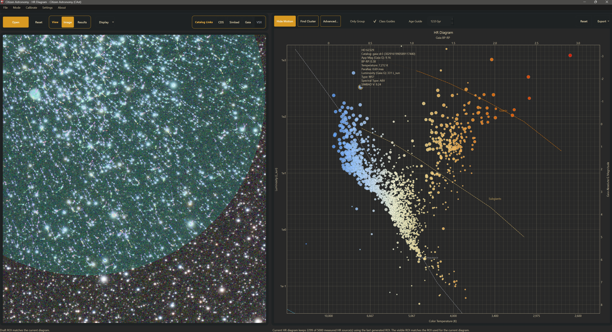

# HR Diagram

## Introduction

Every star has a place on a map drawn more than a century ago -- a map that still tells us more about stellar life than almost any other plot in astronomy.

The Hertzsprung-Russell diagram (HR diagram) places stars by color (temperature) against intrinsic brightness (luminosity). Hot blue stars sit to the left. Cool red stars sit to the right. Giants rise above the main sequence. White dwarfs settle below it. Look at a cluster, and you are not looking at a random spray of points: you are looking at a population that formed together, aged together, and left a fingerprint of that shared history on the diagram.

**Citizen Astronomy (CAst)** turns a single deep image of a star field into an interactive HR diagram. You open a FITS or XISF frame (TIFF, PNG, JPEG, and camera RAW files are also accepted), CAst detects the stars on your image, matches them to Gaia DR3, computes absolute magnitudes from parallax, and plots a color-magnitude diagram you can explore, filter, and export.

### What you can do with this mode

- **Build a color-magnitude diagram from your own data.** See your field in Gaia BP-RP color versus absolute G magnitude, with educational temperature and luminosity scales.
- **Explore stellar populations.** Overlay supergiant, giant, subgiant, main-sequence, and white-dwarf guide curves and an age guide to understand what kinds of stars you are looking at.
- **Find co-moving groups.** Use Gaia proper motions (and parallax when available) to detect stars that share a common space motion -- the kinematic signature of open clusters, associations, and moving groups.
- **Connect the plot to the sky.** Click a point on the diagram and see the same star on your source image, in the Source Results table, and in an info card with SIMBAD type and spectral type.
- **Export figures and tables.** Save themed snapshots, clean scientific plots, annotated source images, and working tables for further analysis.

### Why this matters

Professional surveys have mapped billions of stars, but the educational power of an HR diagram is strongest when it is *your* field -- the cluster you imaged, the association in *your* frame. Seeing the main sequence turn off, spotting a handful of giants, or finding a co-moving subgroup in your own data is how stellar evolution stops being an abstract textbook figure and becomes something you measured.

Amateur images of open clusters, globular clusters, and rich Milky Way fields already contain the photometry and the sky positions. Gaia supplies the colors, parallaxes, and proper motions. CAst brings them together.

---

## How It Works

### Step 1: Choose a Source Image

Switch to **HR Diagram** mode from the mode launcher or with `Mode > HR Diagram`.

Each time you enter HR mode, CAst shows the **HR Diagram prerequisites** reminder until you check **Don't show again for this version**. The reminder comes back after the next app update.

HR mode expects:

- an image CAst can **plate-solve** (embedded celestial WCS, or a recovered solve)
- preferably a **linear, color-calibrated RGB** FITS or XISF image
- network access for Gaia DR3 (VizieR) and SIMBAD lookups

The file dialog (**Select solved RGB source image**) accepts FITS/FIT, XISF, TIFF, PNG, JPEG, and camera RAW files. A monochrome image still works, but only the luminance plane is measured, so there is no instrumental color.

If the embedded WCS is missing or unusable, CAst logs "Embedded WCS was unusable; recovering a plate solution." and runs two solvers at the same time, keeping the first success:

- **astrometry.net**, when an **Astrometry API Key** is set in `Settings > Open Settings > General`
- a **local Gaia match**, which needs the center RA/Dec, focal length, pixel size, and image dimensions in the file metadata

PNG, JPEG, TIFF, and RAW files carry no FITS WCS, so they always use the recovered solve for Gaia matching, the diagram, and the overlays. In practice that usually means astrometry.net.

> **PNG and JPEG caution.** These files are normally stretched, and JPEG is lossy. The Gaia-based axes (Gaia BP-RP, Gaia Absolute G Magnitude) are unaffected because they come from the catalog. The values measured from your pixels (Calibrated, Abs Proxy, Instrumental Blue - Red, SNR) are not linear measurements on such files.

The preview can be stretched for comfortable viewing, but photometric measurement is performed on the original image data.

Unlike Differential Photometry, HR mode works from **one source image at a time**, not a time-series folder.

### Step 2: Open the Image (the Diagram Builds Automatically)

Click **Open** on the HR toolbar, use `File > Open File` (`Ctrl+O`), or click **Source Image...** in the **Results** view. Opening an image clears the previous selection, plot overrides, motion group, and ROI, sets the working directory to the image's folder, and starts the full preparation workflow. While it runs, **Open** reads **Generating...**. CAst then:

1. Resolves the image WCS and field footprint (recovering a plate solution when needed).
2. Queries and caches field catalogs: Gaia DR3 down to **Gaia Max Mag** (default G ≤ 18), plus VSX and exoplanet entries for the log summary. Wide fields are tiled so the catalog covers the whole image.
3. Writes `hr_field_catalog.json` to the working directory.
4. Detects stars on the image itself.
5. Cross-matches detections to Gaia and keeps the brightest matches up to **HR Max Sources**.
6. Measures matched sources through aperture photometry and derives plot quantities (colors, absolute magnitudes, zero point).
7. Writes `hr_working_table.json` and `hr_working_table.csv`, then refreshes the plot and the Source Results table.

The Work Log (in the **Results** view) records each stage and ends with a summary: field center and radius, Gaia stars, VSX variables, exoplanet entries, measured rows, usable rows, rows inside the applied ROI, and the zero-point offset. If something fails, CAst shows **HR preparation failed** and writes the reason to the Work Log.

After the first plot appears, a background SIMBAD search can resolve catalog and designation names for brighter stars (see Settings below). Its progress shows in the footer strip.

### Step 3: Working Directory and Source Limits

The **working directory** stores `hr_field_catalog.json`, `hr_working_table.json`, and `hr_working_table.csv`, and it is the default folder for exports. CAst sets it to the image's folder every time you open an image. To use another folder, click **Working Directory...** in the **Results** view after opening. The new folder is used for exports and for any later re-measurement; files from the first run stay in the image folder.

**HR Max Sources** (in `Settings > Open Settings > HR Diagram`) limits how many Gaia-matched detections are measured:

- default: **5000** (range 0-50000)
- `0` means all matched sources
- the brightest detections (by peak pixel value) are kept first

This limit is the main control on preparation time. The Gaia/VizieR download is limited by **Gaia Max Mag** (default 18.0). Wide crowded fields are queried in tiles (**Tile Radius**, **Tile Overlap**, **Max Tiles**, **Tile Split Depth**) with a total **Gaia Row Cap** so VizieR does not return only a truncated slice of the frame. These controls live in `Settings > HR Diagram` and in the HR Diagram tab of `Settings > Open Settings`. Changes to them take effect the next time you open the image.

### Step 4: Optional ROI, Update, and Reset

After the diagram appears, you can draft a region of interest on the source image:

- choose **Circle ROI** (default) or **Rectangle ROI** under `Settings > HR Diagram > Source Image > Tool`
- hold **Shift** and left-drag on the image to draft; a new drag replaces the previous draft
- a circle grows from where you press; a rectangle spans the drag
- plain drag pans and the mouse wheel zooms
- **Invert ROI** (same menu) flips the mask so stars *outside* the region are kept

Click **Update** to apply the draft. Once the applied ROI matches the draft, the button changes to **Reset**, which clears the ROI (and Invert ROI) and returns to the full field. The footer shows the draft status on the left and the ROI summary on the right.

Detection and measurement always cover the whole field. The ROI controls which already-measured stars appear on the diagram, which is why **Update** is fast when only the ROI changes.

---

## The Measurement Pipeline

### Star Detection on the Image

CAst does not simply drop Gaia catalog positions onto the plot. It first finds stars that are actually present in *your* pixels.

Detection uses `photutils.detection.DAOStarFinder` on the background-subtracted luminance plane (the plain mean of R, G, and B for color images):

- Background median and scatter from 3-sigma clipped statistics.
- Detection threshold: **5 times** the background standard deviation.
- Assumed FWHM for the finder: between 2 and 8 pixels, scaled from the aperture radius (`0.8 * aperture_radius`).
- Border pixels are excluded; detections must lie inside the usable image margin (**Frame Edge Margin**, default 5%, in the Differential Photometry settings tab).
- Candidates are sorted brightest-first by peak value. **HR Max Sources** keeps the first N matched detections in that order.

### Cross-Match to Gaia

Detected positions are converted to sky coordinates through the image WCS and matched to Gaia stars with Astropy's `match_to_catalog_sky`.

The maximum match radius adapts to the plate scale and aperture:

$$
\theta_{\max} = \max\!\left(1.5'',\; \min\!\left(6.0'',\; \max(2.5\,\text{pix}\cdot s,\; r_{\text{ap}})\right)\right)
$$

where $s$ is the mean pixel scale in arcseconds and $r_{\text{ap}}$ is the aperture radius value, used as-is (in pixels) inside the arcsecond comparison. When multiple detections compete for the same Gaia star, the closest match wins. Matches offset by more than 2″ are kept but flagged.

### Aperture Photometry

Matched stars are measured with circular apertures and annuli (same photutils tooling used elsewhere in CAst):

- Fluxes are measured in red, green, and blue channels when available, plus the luminance plane (mean of R, G, B).
- Local sky is the sigma-clipped median in a circular annulus, scaled to the aperture area and subtracted.
- Instrumental magnitudes use $m = -2.5\log_{10}(F)$; the table SNR is the luminance flux over its uncertainty.
- An instrumental color index $B - R = m_B - m_R$ is available as a fallback when Gaia BP-RP is missing.
- Non-positive flux, near-saturation, and (when **Saturation Filter** is on in the Differential Photometry settings tab) saturation are flagged. Saturated stars are tracked separately so **Hide Saturated** can remove them.

### Zero-Point Proxy from Gaia G

For unsaturated stars with positive flux, a Gaia G magnitude, and a usable instrumental luminance magnitude, CAst builds a simple photometric zero point:

$$
\text{ZP} = \mathrm{median}\!\left(G_{\text{Gaia}} - m_{\text{inst, lum}}\right)
$$

Calibrated luminance magnitudes are then:

$$
m_{\text{cal}} = m_{\text{inst, lum}} + \text{ZP}
$$

This is not a full standard-system transformation. It is a practical bridge between your image and Gaia so that a measured absolute-magnitude *proxy* can be computed when useful.

### Absolute Magnitude from Parallax

The default educational Y-axis uses Gaia absolute G magnitude. Given apparent magnitude $m$ and parallax $\varpi$ in milliarcseconds:

$$
M = m + 5\log_{10}(\varpi) - 10
$$

This is the standard conversion when parallax is in mas (equivalent to the usual $M = m - 5\log_{10}(d_{\mathrm{pc}}) + 5$ with $d = 1000/\varpi$).

CAst computes:

- **Gaia Absolute G Magnitude** from Gaia G + Gaia parallax
- **Measured Absolute Magnitude Proxy** from the calibrated luminance magnitude + parallax, when the zero-point step succeeded

Only positive, finite parallaxes are used. Rows without usable parallax can be hidden with **Require Parallax** in Settings.

### Plot Color Index

The default X-axis is **Gaia BP-RP**. If BP-RP is unavailable for a star, CAst falls back to the instrumental blue-minus-red color when that is available. Point display colors preferentially follow a Gaia BP-RP palette, with an instrumental RGB fallback.

---

## Reading the Diagram

### Default Educational View

By default the plot shows:

- **X:** Gaia BP-RP
- **Y:** Gaia Absolute G Magnitude (brighter upward / fainter downward as usual for magnitude axes)

When those axes are active, CAst also shows secondary physical scales:

- **Bottom axis:** approximate color temperature in kelvin
- **Left axis:** luminosity in solar units ($L_\odot$), decade-scaled

The raw Gaia axes move to the top and right when those conversions are meaningful. If you switch to axes where the conversions do not apply, the plot falls back to ordinary bottom/left primary labels.

### Temperature from BP-RP

Color temperature is **not** solved from a full stellar-atmosphere model. It is an educational interpolation between fixed BP-RP and temperature anchors:

| BP-RP | Approx. $T$ (K) |
|---|---|
| -0.4 | 30,000 |
| 0.0 | 10,000 |
| 0.3 | 7,600 |
| 0.6 | 6,200 |
| 0.9 | 5,300 |
| 1.2 | 4,600 |
| 1.5 | 4,000 |
| 1.8 | 3,600 |
| 2.2 | 3,200 |
| 2.6 | 2,900 |
| 3.0 | 2,600 |

Intermediate values are linearly interpolated in BP-RP. Colors outside the table are clamped to the end values. The same conversion fills the **Temperature** line of the info card.

### Luminosity from Absolute Magnitude

Luminosity relative to the Sun uses:

$$
\frac{L}{L_\odot} = 10^{\,(M_{G,\odot} - M_G)/2.5}
$$

with $M_{G,\odot} = 4.67$ as the solar absolute G magnitude constant used in the plot widget. Tick labels are shown as decade-friendly $L_\odot$ values.

### Class Guides and Age Guide

For the Gaia BP-RP versus Gaia Absolute G educational view you can overlay (from the plot toolbar):

- **Class Guides** (default on): dashed Supergiants, Giants, Subgiants, Main Sequence, and White Dwarfs curves
- **Age Guide**: an educational parametric curve at the age set in the box beside it (0.1-13.5 Gyr, default 12.0 Gyr). The turnoff moves redder and fainter as the age grows.

Both guides are hidden for other axis combinations. They are educational overlays, not fitted theoretical isochrones for your specific cluster metallicity and distance.

### Axes

Choose axes in `Settings > HR Diagram > Plot Axes`:

- **X Axis:** Gaia BP-RP (default), Instrumental Blue - Red, or Resolved Color Index (Gaia BP-RP when available, otherwise instrumental Blue - Red)
- **Y Axis:** Gaia Absolute G Magnitude (default), Measured Absolute Magnitude Proxy, Calibrated Luminance Magnitude, or Gaia G Magnitude

### Filtering and Presentation

Useful controls include:

- **Hide Flagged** (default off) and **Hide Saturated** (default on) in the HR Diagram tab of `Settings > Open Settings`
- **Require Parallax** (default on): hides rows without a Gaia parallax, and rows whose selected absolute-magnitude axis cannot be computed
- **Apparent Mag** Min/Max (Gaia G, default -5 to 30) in the same tab
- **Data Point Size**: scaled by Gaia G (5-14 px between the 5th and 95th percentile) or a **Fixed Point Size** (default 8 px)
- **Color Saturation** (default 1.0) and **Opacity** (default 0.8)
- an editable plot title: double-click the title to open **Edit HR Diagram Title**; the title is used in exports and default file names
- display downsampling: the interactive plot shows at most 2000 points, chosen the same way every time, and always keeps the selected star. Scientific exports use every plottable row.

**Filter...** sits on the plot toolbar between **Advanced...** and **Only Group**. Each section has an On/Off switch and stays closed until it is On. A section removes stars only while it is On: stars outside its range, and stars that do not have that measurement. **Apply** writes the ranges and the removal counts to the Work Log. The toolbar button reads **Filter On** while a section is On. **Turn all off** switches every section off; **Apply** again to update the diagram.

- **Color / temperature** uses Gaia BP-RP and the same temperature scale as the plot. A star with no Gaia BP-RP is removed.
- **Distance** is parsecs = 1000 / Gaia parallax in mas. Missing or non-positive parallax is removed.
- **Luminosity** is solar luminosity from Gaia absolute G, with solar absolute G = 4.67. A star with no Gaia absolute G magnitude is removed.
- **Stellar class** uses published SIMBAD spectral classifications by default. **Filter spectral type** and **Filter luminosity class** are independent switches; luminosity-class filtering starts off. A published B star can therefore pass an O+B selection even when its luminosity class is unknown. When both criteria are enabled, a star must match both. **None** ignores a row; **All** selects every supported class in that row, but does not include Unknown classifications.

During generation, one bulk SIMBAD field query retrieves published types, quality flags, and bibliographic references. Results, including empty searches, are cached for 30 days. Matching prefers exact Gaia DR3 identifiers; a position fallback requires a unique counterpart within one arcsecond after moving Gaia positions to epoch J2000 using proper motion. Ambiguous matches and conflicting Gaia IDs are rejected. The Work Log reports coverage and cache/network failures. If SIMBAD is unavailable, an older cache is used when available; otherwise the image still loads with Unknown classifications and Generate retries the lookup.

Literature coverage is incomplete, especially for faint stars. **Allow estimated fallback when no literature type is available** is off by default. Turning it on uses the uncorrected Gaia BP-RP temperature and the nearest luminosity guide within 1.75 mag only for stars without a published type. These estimates are not spectroscopic classifications. Unsupported or ambiguous published types are never replaced with an estimate. A broad `OB` classification passes only when both O and B are selected. Composite types, intermediate luminosity classes, and classes outside the supported groups remain Unknown for the relevant filter.

The star info card shows the original published type, source, reference, and match method. HR JSON and CSV exports retain these fields plus the catalog object name and quality flag. Data source: [CDS/SIMBAD](https://simbad.cds.unistra.fr/simbad/); cite the supplied spectral-type reference when using a classification scientifically. Literature types change class filtering, not the plot's measured axes or its approximate color-temperature scale.

The filter also updates Source Results and the motion overlays. It stays on for this session. Hide Saturated, Require Parallax, the apparent-magnitude range, and Only Group still apply afterward.

Drag the plot to pan, scroll to zoom, and click the plot toolbar's **Reset** to fit all points again.

### Source Results and Selection

Switch the left panel to **Results** to see the **Source Results** table. Its columns are Source, Catalog, Gaia G, BP-RP, Proper Motion (total, mas/yr), Calibrated, Abs Proxy, SNR, Zero Point, and Flags. Click a header to sort; click again to reverse. Pinned rows stay on top, then plotted rows, then the rest. **Table Row Limit** (default 1000) caps how many rows are listed; the selected row is always kept.

Row tints show plot state: blue for plotted, green for manually added, red for manually removed, and gold for motion-group members. The summary line under the table reads "Showing N matching HR row(s), with M currently plotted, from T total row(s)."

Selection is linked across the plot, table, and source image:

- click a plot point to select a star, its table row, and its image position, and open the info card
- double-click a star on the source image to select the nearest measured star and open the info card
- click a table row to highlight the same star on the plot and center it on the image; select several rows to frame the group
- click an empty part of the plot to clear the selection

Right-click the table for **Copy Name**, **Show Selected On Top**, **Add Selected To Plot**, **Remove Selected From Plot**, **Use ROI/Filters For Selected**, **Clear Top Pins**, and **Clear All Plot Overrides**.

The info card lists the star's name, catalog and Gaia DR3 ID, App Mag (Gaia G), BP-RP, Temperature, Parallax, Luminosity, and the SIMBAD **Type** and **Spectral Type** (looked up within 2″ and cached). It adds **SIMBAD V** when that differs from Gaia G by more than 0.05 mag. The card appears only for stars that are currently plotted.

The **Catalog Links** buttons act on the selected star:

- **CDS** opens a VizieR lookup for the best identifier, or the CDS Portal at the star's coordinates
- **Simbad** opens the SIMBAD page for the identifier, or a 2″ coordinate search
- **Gaia** copies the Gaia DR3 source ID to the clipboard and opens a page for that source (SIMBAD when a name is resolved, otherwise VizieR)
- **VSX** opens a VSX page for rows from the VSX catalog. HR rows are Gaia DR3 matches, so this button normally stays disabled.

---

## Find Cluster (Common Motion Group)

Open clusters and moving groups are not defined only by where they sit on an HR diagram. They are also co-moving through space. **Find Cluster** looks for that kinematic signature in your Gaia-matched sample.

Find Cluster searches all measured rows inside the applied ROI. Plot filters (Filter, Require Parallax, Hide Saturated, the magnitude range) and the 2000-point display limit do not change its input. If nothing is found, CAst shows **No cluster found** and suggests narrowing the field with an ROI or checking that Gaia proper motions are available.

### What it uses

For each eligible star:

- proper motion in RA and Dec (mas/yr)
- optionally parallax (mas). In **Auto** parallax mode it is used when at least max(6, 35% of the proper-motion rows) have positive parallax.

Each feature is robustly normalized (subtract the median, divide by 1.4826 × MAD) before clustering.

### Clustering

CAst runs a DBSCAN search:

- **Lightweight** built-in DBSCAN (Auto uses it below 180 eligible points)
- **Sklearn DBSCAN** (Auto uses it at 180+ eligible points), with fallback to the lightweight path if sklearn is unavailable

`min_samples` is $\sqrt{N}$ rounded and clamped to 5-12. The neighborhood size `eps` is the 30th percentile of the k-th neighbor distances × 1.25 × **Strictness**, clamped to 0.25-2.4. A larger Strictness value gives a wider neighborhood, so the search is looser. The largest cluster is retained as the candidate common-motion group, and it must have at least `min_samples` members.

Minimum requirements are intentional and conservative: at least five stars with usable proper motion, and enough points after parallax filtering when parallax mode demands it.

### Presets

Click **Advanced...** on the plot toolbar to open **Motion Group Detection**. Pick a **Preset**, then click **OK**; the next **Find Cluster** uses it.

| Preset | Strictness | Parallax | HR cleanup |
|---|---|---|---|
| **Default** | 1.0 | Auto | On |
| **Tight** | 0.8 | Auto | On |
| **Loose** | 1.35 | Proper motion only | Off |
| **Parallax Priority** | 0.95 | Require parallax | On |
| **Custom** | 0.4-2.5 | any | any |

**Show Expert Controls** reveals **Backend** (**Auto (recommended)**, **Lightweight**, **Sklearn DBSCAN**), **Strictness**, **Parallax** (**Auto**, **Require parallax**, **Proper motion only**), and **Apply HR consistency cleanup**. Changing any expert setting switches the preset to Custom. **Turn on Only Group automatically after detection** is off by default.

### HR Cleanup

After the astrometric cluster is found, optional **HR consistency cleanup** removes members that are outliers in BP-RP / absolute-magnitude space relative to the group. Each member's distance to its second-nearest neighbour is compared with a threshold of median + max(median × (0.4 + 0.2s), max(1.2, 2.4s) × MAD), where s is Strictness. The cleaned group is accepted only if at least max(4, 60%) of the members remain. This reduces contaminants that share motion by chance but do not belong on the same evolutionary sequence.

### Only Group

After a successful detection, **Only Group** becomes available. Checking it shows only the group members on the HR plot, in Source Results, and in the motion overlays. The **Find Cluster** button becomes **Find All**, which clears the motion group and returns to the full HR selection.

Members are highlighted consistently across:

- the HR plot
- Source Results (gold rows)
- source-image selection markers and proper-motion overlays (vectors drawn in gold)
- scientific exports, which outline group members

---

## Source Image Overlays

The left **Image** view keeps your original field in context:

- the measurement aperture circle for each selected star, in the **Selected Circle Color** (labels appear when four or fewer stars are selected)
- outlines for motion-group members
- the draft and applied ROI, in the **ROI Drag Color** while dragging and the **ROI Defined Color** once drawn
- Gaia proper-motion vectors for the currently plotted stars: click **Show Motion** on the plot toolbar (it then reads **Hide Motion**). Vectors need a valid WCS.
- vector color and width settings, plus optional **Color vectors by angle** (similar directions share similar hues) and **Scale vector saturation by magnitude**
- double-click a star on the image to select it (highlights the plot/table and enables the catalog link buttons)

Vector length is scaled between 6 and 36 screen pixels relative to the 95th-percentile proper motion in the field, so the arrows show relative motion, not a time span.

### Display menu (Source Image)

Open **Display** on the HR toolbar for Source Image presentation controls:

- **Stretch:** Auto Stretch, Linear, Asinh, Sqrt, or Log. FITS and XISF images open with Auto Stretch; JPEG, PNG, and other 8-bit files open with Linear.
- **Curves** opens the Curves dialog: drag the points to reshape the tone curve, click the graph to add a point, right-click a point to remove it, then click **Apply**.
- **Reset** clears the curves, zoom, and draft ROI.
- **Show RA/Dec** (default on): live RA/Dec readout at the top-left of the image while hovering
- **Show Grid** (default off): equatorial RA/Dec grid overlay
- **RA Density** / **Dec Density** (2–12, default 5): grid spacing controls, enabled when Show Grid is on

These HR Display options are saved separately and do not change Sky Explorer or Differential Photometry settings. They affect only the preview; measurements use the original image data.

RGB source previews remain in color so the eye can compare the plot to the field.

---

## Update / Reset vs Full Re-prepare

- **Update** applies a draft ROI to already-measured rows without redoing detection and photometry. It is enabled only when a draft exists that differs from the applied ROI. Use this for interactive exploration.
- **Reset** (the same button, once the draft matches the applied ROI) clears the applied ROI and Invert ROI and restores the full measured set.
- Opening an image, including the same image again, always runs a full re-prepare: WCS, catalogs, detection, matching, and measurement.
- If measurement settings changed since the last run (HR Max Sources, aperture or annulus radii, Frame Edge Margin, Saturation Filter), the next **Update** also runs a full re-prepare instead of reusing cached rows.
- Gaia catalog settings (Gaia Max Mag, Gaia Row Cap, tiling) take effect when you open the image again.

Plot filters, axes, guides, colors, and marker sizes never need a re-prepare; the plot redraws as soon as you change them.

---

## Exports

The plot toolbar's **Export** button offers four exports. Save dialogs start in the working directory.

| Export | What you get |
|---|---|
| **Snapshot** | Current plot area exactly as shown (theme, zoom, guides), PNG, PDF, or SVG at 3× screen scale |
| **Scientific** | White-background matplotlib plot of every plottable filtered row at the current axis limits, PNG, PDF, or SVG (220 dpi, 300 dpi for PDF) |
| **Image + Plot...** | Current source-image view and HR plot side by side, PNG |
| **Source Image...** | Current annotated source-image view alone, PNG, JPEG, or BMP |
| **Working table** | `hr_working_table.csv` / `.json`, written automatically to the working directory |
| `File > Export` | Asks for a folder and an **Export Name**, then creates `<name>/` with `<name>_source_image.png`, `<name>_hr_diagram.png` (scientific style), and `<name>_science_table.csv` (the rows in the scientific plot) |

Default file names use the plot title and axes, for example `<title>_<x>_<y>_snapshot.png`, `<title>_<x>_<y>_scientific.png`, `<title>_image_plot.png`, and `<image>_annotated.png`.

Scientific exports outline motion-group members, include the class and age guides when shown, and pin temperature-axis ticks to readable BP-RP temperature anchors.

---

## Limitations

### What HR mode does not do

- **It is not cluster fitting.** Class guides and the age curve are educational overlays, not tailored isochrones for your cluster's age, metallicity, and reddening.
- **It does not correct for extinction or reddening.** Absolute magnitudes come straight from apparent magnitude and parallax, so dusty fields look fainter and redder than they are.
- **It is not full photometric standardization.** The Gaia G zero-point bridge is a practical proxy, not a Johnson/Cousins or Sloan transformation with color terms.
- **It does not replace Gaia Archive science pipelines.** Parallaxes, BP-RP colors, and proper motions come from Gaia; CAst organizes and visualizes them against your image detections.
- **It is single-image.** Time-series variability and multi-epoch photometry belong in Differential Photometry / Transient Finder, not here.
- **Crowded cores remain hard.** DAOStarFinder + aperture photometry can blend or miss stars in dense cluster cores where PSF photometry would do better.
- **Motion groups are statistical.** Common proper motion does not prove physical membership by itself. Chance alignments, binaries, and field contaminants remain possible.

### What could be improved

- Reddening / extinction corrections and true isochrone overlays for specific clusters
- PSF photometry for crowded fields
- Explicit membership probabilities instead of a single dominant DBSCAN cluster
- Extend literature spectral-type coverage with additional published catalogs
- Distance-prior or Bayesian absolute-magnitude treatments for noisy parallaxes

---

## Conclusion

An HR diagram is a story about how stars are born, live, and die -- told in color and brightness. With one deep image and Gaia behind it, CAst lets you place *your* field on that story: see the main sequence, notice the outliers, chase a co-moving group, and export figures you can share, teach with, or study further.

The diagram on your screen is not just a plot. It is a census of the stars you pointed at, drawn with the same axes astronomers have used for more than a hundred years.

Every cluster begins as a cloud. Every sequence on the diagram begins with someone deciding to look.
