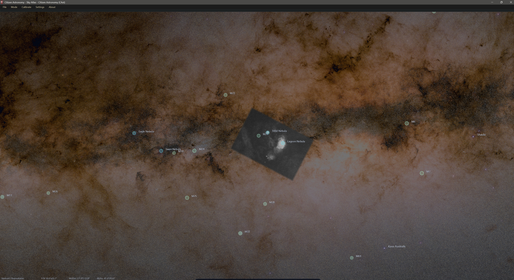

# Sky Atlas

## Introduction

**Sky Atlas** is CAst's interactive all-sky map. You can search every downloaded catalog from a centered window, click objects to pin their details, change the observing time and site, tune how many stars and deep-sky objects are drawn, inspect the live Moon, and lay your own sky-registered images over the atlas as custom surveys. Use it when you want context: where an object sits, what surrounds it, and how the sky looks from a given place at a given time.

Some controls still use the older name **Sky View** (for example the **Sky View options** tooltip). In the launcher and the **Mode** menu the mode is called **Sky Atlas**.

### What you can do with this mode

- **Explore the sky interactively.** Drag to pan, scroll to zoom, search, and click visible targets to see their RA, Dec, altitude, azimuth, and constellation.
- **Simulate time and location.** Set the UTC time, step by hours or days, pause or play the clock, and pick your observing site on a world map.
- **Control star and deep-sky density.** Choose a limiting magnitude up to 15.0 (Hipparcos, Tycho-2, or Gaia DR3) and which deep-sky catalogs are plotted.
- **Render the Milky Way and constellations.** Adjust Milky Way detail and tone, and style constellation lines and labels.
- **Find the Moon.** Search for the Moon and see its topocentric position for your site and time.
- **Overlay your own images.** Import sky-registered PNG, XISF, TIFF, or FITS images into named custom surveys and display them on the atlas.

### Why this matters

A star chart is most useful when it matches your situation: your site, your night, the target you care about. Sky Atlas combines packaged catalogs, downloadable all-sky star data, and your own overlay images, so you can move between planning, outreach, and visual inspection without leaving the app.

---

## How It Works

### Step 1: Open Sky Atlas

Click **Sky Atlas** on the mode launcher ("Explore the sky and objects with an interactive all-sky map."), or choose **Mode > Sky Atlas**.

On first use, the atlas opens on a 60° field centered on Orion and shows stars down to about magnitude 5. Fainter catalog stars fade in gradually as you zoom in, up to the **Limiting magnitude** set in **Sky Atlas Settings**, and the already-visible stars brighten so the step between magnitudes stays even. All-sky views keep stars small. The first paint uses the bright star subset and the existing Milky Way preview, so the atlas appears quickly; deeper catalogs are loaded only when you ask for them in **Sky Atlas Settings**, or when no Hipparcos stars are on disk yet.

### Step 2: Find the controls

The atlas fills the window. The controls sit in a dock at the bottom centre that slides in when you move the pointer near the bottom edge and slides away when you move it up again. It stays visible while one of its popups is open. From left to right the dock buttons are (hover to see each tooltip):

| Tooltip | What it does |
|---------|--------------|
| **Search the sky** | Opens the search window |
| **Date and time** | Opens the UTC time popup |
| **Pause time** / **Play time** | Stops or resumes the simulation clock |
| **Observer location** | Opens the **Observer Location** dialog |
| **Toggle equatorial grid** | Shows or hides the RA/Dec grid |
| **Toggle alt-az grid** | Shows or hides the altitude/azimuth grid |
| **Toggle constellations** | Shows or hides constellation lines and names |
| **Toggle ground and horizon** | Shows or hides the ground and horizon |
| **Custom sky map overlays** | Opens the **Custom Sky Map** popup |
| **Sky Atlas settings** | Opens **Sky Atlas Settings** (stars and deep-sky catalogs) |
| **Sky View options** | Opens the Milky Way, constellation, and reset popup |
| **Toggle full screen** | Switches the window in and out of full screen |

The grids, constellations, and ground start switched off. The clock starts running.

The footer at the bottom of the atlas shows the observer site name (or **Not set** if no site is configured), the field of view, the RA/Dec of the view centre, and the Alt/Az of the view centre.

### Step 3: Search for a target

Click **Search the sky**. A centered window titled **Search the sky** opens with the note `Every catalog is included, even layers you have turned off.`

1. Type a name, catalog ID, or alias in the box (`Type a name, catalog ID, or alias…`).
2. The status line shows **Searching…** while catalogs are scanned, then the number of matches, `most relevant first`.
3. Each result row starts with the object type, for example `Galaxy  Andromeda Galaxy`. A second line shows the catalog, the magnitude, and the constellation when known.
4. Click a result, or press **Enter** to go to the highlighted one. Use the **Up**/**Down** arrow keys to move from the box into the list. Press **Esc** to close.

Choosing a result centers the atlas on the object, selects it, and pins its details in the object panel. If the object belongs to a catalog you have hidden, Sky Atlas still pins it so you can inspect it.

### Step 4: Set the time

Click **Date and time**. The popup shows a **UTC** date/time editor (with a calendar popup) and five buttons:

- **-1 d**
- **-1 h**
- **Now**
- **+1 h**
- **+1 d**

Click **Pause time** in the dock to freeze the sky at the current moment; the same button then reads **Play time**. While the clock runs, stars and objects move smoothly with the sky.

### Step 5: Set the observer location

Click **Observer location**. The **Observer Location** dialog opens with a world map on the left and a **Saved Site** card on the right.

1. Drag the map to pan. Scroll, or use the **-** and **+** buttons, to zoom. **Center on marker** returns to the selected point.
2. Click the map to place the marker, or type **Latitude**, **Longitude**, and **Elevation**.
3. **Name** fills in automatically from the clicked coordinates (`Auto-filled from clicked coordinates.`). Type your own name to override it; clear the field to turn auto-fill back on.
4. Leave **Keep this site in quick-switch presets** checked to keep the site in the **Saved Sites** list.
5. Click **Save Location**.

To reuse a site, pick it from **Saved Sites** and click **Load**, then **Save Location**. **Remove** deletes the selected saved site.

The location is saved as CAst's observing site, so the same site is used the next time you open Sky Atlas. It changes:

- altitude and azimuth of every object
- the horizon and ground
- the live Moon position

The map tiles come from CARTO, and the place label from OpenStreetMap Nominatim, so the map and the auto-filled name need an internet connection.

### Step 6: Turn layers on and off

Use the dock toggles:

- **Toggle equatorial grid**
- **Toggle alt-az grid**
- **Toggle constellations**
- **Toggle ground and horizon**
- **Custom sky map overlays**

Then open **Sky Atlas settings** for stars and deep-sky catalogs, and **Sky View options** for the Milky Way and constellation styling.

---

## Searching and Inspecting Objects

### Mouse controls

- **Drag** with the left mouse button to pan.
- **Scroll** to zoom. The field of view glides continuously between 2° and 360°. When the Moon is selected or centered, you can zoom in to about 0.24°.
- **Hover** over an object to highlight it and show its label.
- **Click** a star or object to select it and pin its details.
- **Double-click** an object to center the view on it and pin it.

The atlas has no keyboard shortcuts of its own. In the search window, **Enter**, **Esc**, and the arrow keys work as described above.

### Pinned object panel

The object panel appears at the top left when you select something and hides again when nothing is selected. It shows:

- the object name and magnitude (`mag`)
- up to four alternate names, or the catalog name
- the object type
- literature links: **SIMBAD**, **ADS**, **VizieR**, and **HASH** when the object is a HASH PN
- **RA**, **Dec**, **Alt**, **Az**, and **Constellation**

The links open in your browser. SIMBAD opens the object record, ADS searches papers sorted by citation count, and VizieR searches by the identifier. The **HASH** link opens the object's row in VizieR catalogue V/163. Alt and Az update as the clock runs or when you change the site.

### What can be searched

Search covers:

- packaged named stars and atlas targets, including the packaged Messier catalog
- every deep-sky catalog already downloaded to disk (NGC, IC, VdB, LDN, LBN, Barnard, Sharpless, RCW, HASH PN), even when it is switched off in **Sky Atlas Settings**
- objects currently drawn on the atlas
- the live **Moon**

Search does not download anything. A catalog you have never enabled is not searchable until you enable it once in **Sky Atlas Settings** and click **OK**. Named stars stay searchable; unnamed catalog stars are left out so the list stays useful. Named objects rank ahead of unnamed ones, and one-letter queries match names only. The list holds up to 60 results.

---

## Built-In Catalogs and Data

### Stars

Sky Atlas uses a tiered full-sky star strategy. Depending on the limiting magnitude, it loads:

- **Hipparcos** (VizieR I/239)
- **Tycho-2** (VizieR I/259)
- **Gaia DR3** (streamed from the Flatiron Gaia DR3 mirror)

Hipparcos to magnitude 9.5 is always the base set once it has been downloaded. The settings dialog estimates star counts and download sizes for the chosen depth. Examples from the built-in estimator:

- mag `9.5`: Hipparcos, about `99k` stars (12 MB)
- mag `12.5`: Tycho-2, about `1.8M` stars (240 MB)
- mag `15.0`: Gaia DR3, about `35M` stars (4.8 GB)

Catalogs are saved under a `sky-atlas` folder next to the program; the dialog shows the exact path after **Saved under:**.

### Deep-sky catalogs

The deep-sky catalogs are:

- **Messier** (packaged)
- **NGC** and **IC** (VizieR VII/118)
- **VdB** reflection nebulae (VII/21)
- **LDN** dark nebulae (VII/7A)
- **LBN** bright nebulae (VII/9)
- **Barnard** dark nebulae (VII/220A)
- **Sharpless** HII regions (VII/20)
- **RCW** southern HII regions (VII/216)
- **HASH PN** planetary nebulae and known mimics (V/163)

Messier and NGC are on by default. Each catalog can be switched on or off in **Sky Atlas Settings**. Barnard, Sharpless, RCW, and HASH PN are useful for checking whether a nebula is already catalogued. HASH PN labels use the usual name when HASH provides one, including amateur discoverer names such as **StDr-1**, Pa, Kn, and Ou, and keep the HASH number as an alias. Search accepts common spellings (`StDr-1`, `StDr 1`, `StDr1`).

Object names, constellation names, and deep-sky marker circles are drawn on the GPU. Dense catalogs (HASH PN, LDN, LBN, Barnard, Sharpless, RCW) wait for a closer zoom before showing labels: named objects below about 28° field width, unnamed ones below about 10°. Only the most relevant names are drawn so the view stays responsive. CAst downloads these catalogs from CDS/VizieR when you enable them; it does not redistribute the HASH database.

### The Moon

Search for **Moon**, **Luna**, or **Earth's Moon** to get a live topocentric Moon object computed from the current observer location and simulation time. Its listed magnitude is estimated from the illuminated fraction. Selecting the Moon lets you zoom in much closer than other targets.

---

## Settings

Click **Sky Atlas settings** in the dock. The **Sky Atlas Settings** dialog opens with the intro:

`Adjust what stars and deep-sky objects appear in Sky Atlas.`

The left list switches between the **Stars** and **Deep-Sky Objects** pages. Changes preview on the atlas as you move the controls. **OK** saves them, **Cancel** reverts to the saved values, and **Restore Defaults** resets every control in the dialog.

### Stars page

| Control | Range | Default | Description |
|---------|-------|---------|-------------|
| **Limiting magnitude** | 3.0–15.0 | 8.7 | Fainter stars fade out beyond this value |
| **Star brightness** | 0.35x–2.00x | 1.00x | Overall glow intensity |
| **Star size** | 0.40x–2.50x | 1.00x | Base disc size for all stars |
| **Magnitude size contrast** | 0.00x–2.00x | 1.00x | How strongly fainter stars shrink relative to bright ones |
| **Twinkling** | 0–100% | 50% | Atmospheric scintillation amount |

The **Star catalog download** box shows the estimated catalog, star count, and size for the chosen limiting magnitude, the folder after **Saved under:**, and this note:

`Click OK to download any missing catalog data in the background. You can keep using Sky Atlas; Cancel or quitting the app keeps the last working magnitude.`

When you click **OK**, a banner with a progress bar and a **Cancel** button appears at the top of the atlas if catalog data is missing. The current sky stays on screen and only refreshes when the new catalog is ready. Gaia is streamed as one catalog file, so progress follows the stars and megabytes actually received. A finished download keeps the new magnitude the next time you open Sky Atlas. If you click **Cancel**, or quit mid-download, the last working magnitude is kept so the next launch does not retry a stuck download. If a deeper download does not finish, the status bar shows `Sky Atlas kept the last complete star catalog; the deeper download did not finish.`

### Deep-Sky Objects page

- **Catalogs to show**: one checkbox per catalog listed above.
- **Visibility**:
  - **Object limiting magnitude** (1.0–16.0, default 10.0): marks objects brighter than this limit.
  - **Label limiting magnitude** (1.0–16.0, default 8.0): shows names only for objects brighter than this.

Use these to keep the atlas clean for outreach or make it denser for checking a field.

---

## Rendering and Visual Controls

Click **Sky View options** in the dock. The popup has three groups and a **Reset View** button.

**Max mag** at the top shows the current star limiting magnitude. Change the limit in **Sky Atlas Settings**.

### Milky Way

The background is the previous all-sky Milky Way texture (ESA Gaia Sky 2020), not the later starless Gaia glow.

| Control | Options or range | Default |
|---------|------------------|---------|
| **Milky Way** checkbox | on/off | On |
| Resolution (next to the checkbox) | **Off**, **Low** (4k), **Medium** (8k), **High** (32k tiles) | High |
| **Mode** | **Basic Milky Way**, **Advanced Milky Way (16k)**, **High Detail Milky Way (32k)**, **Fully Milky Way** | Fully Milky Way |
| **Opacity** | 0–80% | 65% |
| **Exposure** | 0.35x–1.80x | 1.30x |
| **Preset** | **Atlas**, **Dark sky**, **Source-like**, **Custom** | Atlas |
| **Contrast** | 0.60x–2.20x | 1.35x |
| **Saturation** | 0.00x–2.40x | 2.00x |
| **Black point** | 0.00–0.25 | 0.00 |
| **Gamma** | 0.60x–1.80x | 1.05x |
| **Flip texture** | on/off | Off |

Choosing a **Preset** sets **Exposure**, **Contrast**, **Saturation**, **Black point**, and **Gamma** together. Moving any of those sliders yourself switches the preset display to **Custom** when the values no longer match a preset. Setting the resolution to **Off** hides the Milky Way.

### Constellations

| Control | Options or range | Default |
|---------|------------------|---------|
| **Constellations** | on/off (same as **Toggle constellations**) | Off |
| **Lines** | on/off | On |
| **Labels** | on/off | On |
| **Color** | **Blue-white**, **Gray-white**, **Soft cyan**, **Warm amber** | Blue-white |
| **Line width** | 0.5–3.0 px | 1.0 px |
| **Line opacity** | 0–100% | 42% |
| **Label opacity** | 0–100% | 72% |
| **Label size** | 8–20 pt | 11 pt |

### Reset View

**Reset View** animates the camera back to the opening 60° Orion field.

The **Sky View options** settings and the dock toggles are not saved between sessions; they return to their defaults when you restart CAst. **Sky Atlas Settings**, the observer location, and the custom overlay settings are saved.

---

## Custom Surveys and Overlays

### What custom surveys are

Click **Custom sky map overlays** in the dock to open the **Custom Sky Map** popup. A custom survey is a named group of your own sky-registered images, for example one survey per filter. Sky Atlas draws the images of the selected survey on the atlas at their sky positions.

### Supported input formats

- **PNG**
- **XISF**
- **TIFF** (`.tif`, `.tiff`)
- **FITS** (`.fit`, `.fits`)

Other file types are rejected with:

`Sky Atlas custom overlays support PNG, XISF, TIFF, and FITS images only.`

### How to create a survey

1. Click **Custom sky map overlays**, then **Edit Surveys**.
2. In the **Custom Sky Map Surveys** dialog, click **New Survey**. It appears in the **Surveys** list as `Survey 1`, `Survey 2`, and so on.
3. Type a **Name** and, optionally, choose or type a **Filter** (the list offers Luminance, Clear, R, G, B, Ha, OIII, and SII).
4. Click **Add Image...** and choose one image. Repeat for each image you want in the survey.
5. Click **OK** to save the surveys.

While an image imports, a **Sky Atlas** progress window shows `Reading WCS or plate-solving the overlay image...`. Sky Atlas uses the embedded WCS when it is valid. For PNG and TIFF it first looks for a FITS file with the same base name (`.fits`, `.fit`, `.fts`, or `.fz`) next to the image. If no usable WCS is found, it tries to plate-solve the image with metadata-seeded Gaia matching or astrometry.net (using the astrometry.net API key from CAst's settings). If that fails, `Custom overlay failed` explains why.

Other survey actions:

- **Remove Selected** removes the selected image from the survey.
- **Delete Survey** deletes the selected survey; if it has images, CAst asks for confirmation first.
- Every survey needs a name; **OK** refuses an empty name with `Every survey needs a name.`

### How to show a survey

1. Click **Custom sky map overlays**.
2. Pick the survey from the **Survey** dropdown. Picking a survey also turns on **Show custom sky overlays**. Use the checkbox to hide or show the overlays later.
3. Tune the display:

| Control | Range | Default |
|---------|-------|---------|
| **Opacity** | 0–100% | 85% |
| **Brightness** | 0.35x–2.00x | 1.00x |
| **Saturation** | 0.00x–2.40x | 1.00x |
| **Feather** | 0–100% | 0% |
| **Treat black as alpha** | on/off | Off |

**Feather** fades the image edges into the atlas. **Treat black as alpha** makes black and near-black pixels transparent so the overlay blends into the atlas sky. The dropdown shows **No surveys yet** until you create one.

### How the data is stored

Surveys are saved in a `survey` folder next to the program, one subfolder per survey with a `survey.json` manifest. Each imported image gets its own folder containing:

- a cached `overlay.png`
- a cached `overlay.wcs.fits`
- an `overlay.json` manifest

Cached images are downscaled to a long edge of 2048 pixels by default. Survey folders are portable: as the dialog notes, you can share a survey by copying its subfolder.

---

## Observer Location and Time Workflow

### Location workflow

- Open **Observer location**, click the map or type coordinates, and click **Save Location**.
- Keep **Keep this site in quick-switch presets** checked to add the site to **Saved Sites**.
- Switch sites later with **Saved Sites**, **Load**, and **Save Location**.

### Time workflow

- Jump to **Now**.
- Step by hours or days with **-1 h**, **+1 h**, **-1 d**, and **+1 d**, or type a UTC time.
- Click **Pause time** to inspect one moment, then **Play time** to let the sky move again.

This is useful for:

- horizon checks
- constellation orientation
- Moon position
- outreach and teaching

---

## Suggested Workflow

1. Open **Sky Atlas**.
2. Click **Observer location** and save your observing site.
3. Click **Date and time** and set the night you care about.
4. Click **Search the sky** and look up a named star, a Messier target, or the Moon.
5. Turn on constellations, grids, or the ground and horizon from the dock.
6. Open **Sky Atlas settings** and choose a limiting magnitude and the deep-sky catalogs that match your goal.
7. If you have your own registered images, add them in **Custom Sky Map Surveys** and pick the survey in **Custom Sky Map**.
8. Fine-tune the Milky Way and constellation styling in **Sky View options**.

---

## How This Differs from Other Modes

| Mode | Sky Atlas relationship |
|------|------------------------|
| **Sky Explorer** | Anchored to one image and its WCS; Sky Atlas is an all-sky interactive environment |
| **Distance Map** | Builds a Gaia-based 3D field visualization; Sky Atlas is a navigable 2D sky context view |
| **HR Diagram** | Builds a stellar population plot from one image; Sky Atlas helps you understand where objects sit on the sky |
| **Differential Photometry** | Measures variability in time-series data; Sky Atlas is for exploration, context, and planning |

---

## Limitations

### What Sky Atlas does not do

- It is not a full planetarium; it shows the catalogs listed above, the Moon, and your own overlays.
- It is not an image-anchored annotation mode like Sky Explorer.
- It has no export or screenshot command.

### Practical caveats

- Deep star catalogs can be large, especially at Gaia DR3 depth. Downloads run in the background with a cancellable progress bar, and quitting keeps the last working magnitude.
- Hipparcos, Tycho-2, Gaia DR3, and the deep-sky catalogs (except Messier) are downloaded on first use. The location map and place labels also need an internet connection.
- Search only covers catalogs already on disk and returns up to 60 results.
- Custom overlays need a valid WCS or a successful plate solve.
- Imported overlays are downscaled into the cache for display.
- **Sky View options** and the dock toggles reset when CAst restarts.
- If GPU star rendering is unavailable, the status bar reports that compatibility rendering is active, which may be slower.
- Some controls still say **Sky View** even though the mode is **Sky Atlas**.

---

## Conclusion

Sky Atlas is CAst's exploration and context mode. It takes you from "which object do I want?" to "what does the sky around it look like, from my site, at my time, with my own images on the map?" If you want a navigable sky map rather than a single-image analysis tool, start here.

For shared shell conventions and themes, see [Themes, Layout, and Shared UI](themes_layout_ui.md).
