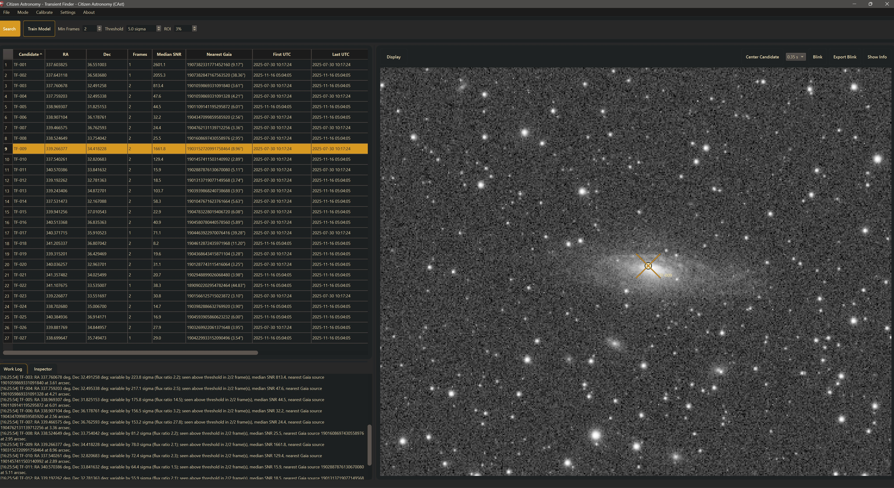

# Transient Finder

## Introduction

Some of the most important things in the sky do not move -- they change.

A star that was quiet last night can brighten tonight. A source can appear where nothing was visible before. Another can fade until it is gone. Novae, supernovae, flaring stars, eclipsing systems at the right phase, and other abrupt or repeating brightness changes all share that signature: the same sky position, different brightness across repeated frames.

**Citizen Astronomy (CAst)** includes **Transient Finder** for that problem. You open a folder of repeated images of the same field. CAst solves missing WCS when needed, detects point sources, groups detections that share a fixed sky position, re-measures every group on every solved frame, and keeps the groups whose frame-to-frame flux change is larger than static stars and ordinary seeing would produce.

This is not asteroid hunting. Moving objects belong in Asteroid/Comet Detection. Transient Finder looks for **stationary** sources that brighten, fade, appear, or disappear.

### What you can do with this mode

- **Search repeated frames** of one field for fixed positions that brighten, fade, appear, or disappear.
- **Solve unsolved frames** by racing metadata-seeded local Gaia matching with astrometry.net (when an API key is set), and cache the solved WCS for reuse.
- **Use one shared Gaia DR3 comparison catalog** (G ≤ 18) for the whole sequence instead of a catalog query per frame.
- **Review candidates** in a sortable table, with an Inspector summary, crosshair markers on the image, **Center Candidate**, and **Blink** across every measured frame.
- **Export blink animations** (GIF or MP4) of a candidate for sharing or follow-up discussion.
- **Score candidates with a local model** through **Train Model** and the **ML Score** column, when saved training labels exist (see [Machine Learning Assist](#machine-learning-assist)).

### What a candidate means

A row in the candidate table means that, at that sky position, the aperture flux in the brightest measured frame is significantly higher than in the faintest measured frame. It does **not** mean the source is new, astrophysical, or uncatalogued. Hot pixels, cosmic rays, satellite trails, a cloudy or defocused frame, a slow-moving asteroid, a known variable star, and a galaxy core seen through changing seeing can all pass the screen. Treat every candidate as something to check (see [Checking a Candidate](#checking-a-candidate)).

### Why this matters

Professional transient surveys watch large parts of the sky, but they cannot watch every amateur field, every cadence, and every filter. Your sequence may catch a flare, an eclipse, or a brief event at a time nobody else sampled. Transient Finder is a triage tool: it does not replace careful photometry or formal reporting, but it points you to the handful of sky positions worth a closer look.

---

## How It Works

### Step 1: Switch Mode and Open a Folder

1. On the mode picker, click **Transient Finder** (under **Detect & Measure**), or choose **Mode > Transient Finder**.
2. Click **Open** on the workflow row, or choose **File > Open Folder** (`Ctrl+Shift+O`).
3. In **Select transient image folder**, choose the folder that holds your repeated frames.

Opening a folder clears any previous results, writes `Opened transient image folder: …` to the **Work Log**, and previews the first supported image it finds. The **Open** button changes to **Search**. Opening does **not** start the search.

To pick a different folder later, use **File > Open Folder**; once a folder is open, the workflow-row button always runs **Search**.

### Step 2: Set the Search Controls

The workflow row holds three search controls:

| Control | Default | Range | Role |
|---|---|---|---|
| **Min Frames** | 2 | 1–99 | The search needs at least this many solved frames, and a candidate must be measurable in at least this many of them. |
| **Threshold** | 5.0 sigma | 1.0–50.0 (steps of 0.5) | Point-source detection threshold above the clipped background noise. Several later tests scale with it. |
| **ROI** | 3% | 0–45% | Border, as a percentage of the shorter image side, excluded from detection to avoid corner and edge artifacts. The excluded border is drawn on the image as you change it. |

See [Search Settings in Detail](#search-settings-in-detail) for how each value changes the result.

### Step 3: Search

Click **Search**. The button changes to **Searching...**, the three controls are locked, and an indeterminate progress bar runs under the workflow row. Progress lines are written to the **Work Log** with `[HH:MM:SS]` timestamps, for example `[WCS 3/12] Checking …` and `[Transient 3/12] Detecting point sources in …`.

When the search finishes, the full report is appended to the **Work Log**, the candidate table fills, the first candidate is selected, and the solved frames are preloaded in the background so blinking starts quickly.

There is no Cancel button. Switching to another mode cancels a running search unless **Keep mode memory when switching** is enabled in **Settings > Open Settings > General**.

---

## Input Requirements

| Requirement | Detail |
|---|---|
| Formats | `.fit`, `.fits`, `.xisf`, `.tif`, `.tiff`, and camera RAW files. `.jpg`, `.jpeg`, and `.png` are skipped. |
| Folder layout | See [Which files are searched](#which-files-are-searched). |
| Frames | Repeated frames of roughly the same field. Similar pointing, filter, and exposure give cleaner results. |
| WCS | Embedded celestial WCS is used when valid. Otherwise CAst tries to solve the frame. |
| Timestamps | `DATE-OBS` from the header. Values without a timezone use **Image Timestamp Timezone** (**Settings > Open Settings > Differential Photometry > Science Export**, default UTC). |
| Minimum solved frames | **Min Frames** (default 2). The variability test always needs at least two measured frames. |

Color data (RGB FITS/XISF/TIFF, and demosaiced camera RAW) is averaged into one mono plane for detection and measurement. This is a synthetic luminance, not a calibrated band. For precise work, use calibrated single-channel frames.

### Which files are searched

The scan is not fully recursive. CAst looks in this order and uses the first level that contains images:

1. If the folder has a `Files` subfolder, the images inside each subfolder of `Files`.
2. Otherwise, the images inside each direct subfolder of the opened folder.
3. Otherwise, the images directly inside the opened folder.

If the opened folder has both loose images and subfolders with images, only the subfolders are searched. Images two levels deep are not searched. Every searched image is treated as part of one sequence, sorted by `DATE-OBS` and then file name.

### Plate solving

For each frame, CAst first validates the embedded WCS. If it is missing or unusable:

- **Local Gaia matching** runs when the header has center RA/Dec, focal length, pixel size, and image dimensions. It matches detected stars to Gaia DR3 near the header pointing.
- **astrometry.net** runs at the same time when **Astrometry API Key** is set in **Settings > Open Settings > General**. **Astrometry Timeout** (default 300 s, range 30–3600 s) applies.
- The first solver to succeed wins. The solved FITS is stored under the cache directory in `transient-wcs/` and reused next time.
- Frames that still have no WCS are skipped, with `Skipped <file>: <reason>` in the report notes.

**File > Clear All Cache…** deletes all cached solutions and catalogs (settings are kept); the next search solves again.

---

## The Search Pipeline

### 1. Scan and Resolve WCS

Described above. The report line `Solved frames: N/M (K solved through astrometry.net)` summarizes the result.

### 2. Shared Gaia Comparison Catalog

Transient Finder builds **one combined footprint** for the solved sequence (mean center, with a radius that covers every frame) and runs **one magnitude-limited Gaia DR3** query:

- Limit: **Gaia G ≤ 18.0**
- Wide fields are tiled so the whole footprint is covered.
- The result is cached under the cache directory in `catalogs/` and reused for the same footprint.
- The report line `Gaia comparison sources loaded: N` gives the count.

If the Gaia query fails, the search continues without catalog context and notes `Gaia lookup unavailable for this field: …`. In that case the Nearest Gaia column shows `-` and the Gaia neighbor rejection (step 7) cannot apply.

### 3. Per-Frame Point-Source Detection

On each solved frame:

1. Convert to one mono plane.
2. Estimate sigma-clipped background median and standard deviation over the whole frame.
3. Run `DAOStarFinder` on the background-subtracted frame with FWHM **3.0 px** and threshold `Threshold × σ`, keeping at most the **25,000** brightest sources.
4. Reject sources inside the edge margin: the larger of **6 px** and **ROI %** of the shorter image side.
5. Convert pixel centroids to RA/Dec with the frame WCS.
6. Keep sources whose detection SNR is at least **Threshold**.
7. Record the nearest Gaia source (name and separation) from the shared catalog.

$$
\mathrm{SNR}_{\mathrm{det}} = \frac{\mathrm{peak}}{\sigma_{\mathrm{background}}}
$$

The report line `Point-source detections retained before variability screening: N` gives the total across frames.

### 4. Group by Fixed Sky Position

Detections from all frames are linked when they lie within **2.5 arcsec** of each other (friends-of-friends linking, so a chain of close detections becomes one group). Within a group, a frame contributes at most one detection (the higher-SNR one). The group center is the mean sky position of its detections.

This is the key difference from asteroid discovery: Transient Finder assumes the interesting source stays put.

### 5. Aperture Re-Measure on Every Frame

For each group, CAst projects the group center into **every** solved frame (not only frames with a detection) and measures aperture photometry there. With the 3.0 px FWHM:

$$
\begin{aligned}
R_{\mathrm{ap}} &= \max(3,\, 1.75\,\mathrm{FWHM}) = 5.25\ \mathrm{px} \\
R_{\mathrm{in}} &= R_{\mathrm{ap}} + \max(3,\, 1.25\,\mathrm{FWHM}) = 9.0\ \mathrm{px} \\
R_{\mathrm{out}} &= R_{\mathrm{in}} + \max(4,\, 1.75\,\mathrm{FWHM}) = 14.25\ \mathrm{px}
\end{aligned}
$$

Background is the sigma-clipped annulus median $b$, and noise is the clipped annulus standard deviation, floored at a quarter of the frame-wide σ:

$$
\begin{aligned}
F &= \sum_{i \in \mathrm{ap}} (p_i - b) \\
\sigma_F &= \sigma_{\mathrm{local}}\sqrt{N_{\mathrm{ap}}} \\
\mathrm{SNR}_{\mathrm{ap}} &= F / \sigma_F
\end{aligned}
$$

A frame is not measured when the position falls within $\lceil R_{\mathrm{out}} \rceil + 2 = 17$ px of an edge, or when the annulus has fewer than 10 finite pixels or the aperture fewer than 4. Those frames are left out of the candidate's measurements and its blink sequence.

### 6. Variability Screen

From the measured frames, CAst takes the frame with the highest aperture flux (brightest) and the frame with the lowest (faintest):

$$
\begin{aligned}
\Delta F &= F_{\mathrm{bright}} - F_{\mathrm{faint}} \\
\sigma_\Delta &= \sqrt{\sigma_{\mathrm{bright}}^2 + \sigma_{\mathrm{faint}}^2} \\
\mathrm{variability\_snr} &= \Delta F / \sigma_\Delta \\
\mathrm{noise\_floor} &= \max(\sigma_{\mathrm{bright}},\, \sigma_{\mathrm{faint}},\, 1) \\
\mathrm{flux\_ratio} &= \frac{F_{\mathrm{bright}} + \mathrm{noise\_floor}}{\max(F_{\mathrm{faint}},\, \mathrm{noise\_floor})}
\end{aligned}
$$

A group is kept only if all of these hold:

1. At least two frames were measured, and at least **Min Frames**.
2. The brightest frame has positive flux and $\mathrm{SNR}_{\mathrm{ap}} \ge$ **Threshold**.
3. $\mathrm{variability\_snr} \ge \max(7.0,\, 1.25 \times \mathrm{Threshold})$ (8.75 at the default threshold).
4. At least one of:
   - $\mathrm{flux\_ratio} \ge 2.0$;
   - an **absent epoch**: the faintest frame has $F \le 0$ or $\mathrm{SNR}_{\mathrm{ap}} \le \max(2,\, 0.55 \times \mathrm{Threshold})$;
   - the **host-background exception**: $\mathrm{variability\_snr} \ge \max(28,\, 5 \times \mathrm{Threshold})$, $\mathrm{flux\_ratio} \ge 1.35$, and a peak ratio $\ge 1.45$, where the peak ratio compares the highest and lowest per-frame peak SNR as $(\mathrm{peak}_{\max} + 1) / \max(\mathrm{peak}_{\min} + 1,\, 1)$.
5. At least one frame has positive flux with $\mathrm{SNR}_{\mathrm{ap}} \ge$ **Threshold**.

The host-background exception lets a strong brightening on top of a bright galaxy core pass even when the summed aperture flux changes by less than a factor of two.

### 7. Gaia Neighbor Rejection

If any detection in the group has a Gaia (G ≤ 18) source within **5 arcsec** and the flux ratio is below **2.0**, the group is rejected. This removes ordinary catalog stars that wiggle with seeing. It applies even when the absent-epoch or host-background test passed, so a real event close to a Gaia star needs a flux ratio of at least 2.0 to survive.

The report line `Rejected N of M source group(s) as static or seeing-driven.` counts every group removed in steps 6 and 7.

### 8. Ranking and Caps

Survivors are sorted by variability SNR (then flux ratio, then max SNR) and numbered `TF-001`, `TF-002`, …. At most **500** candidates are kept; if more pass, the report notes `Candidate list capped at the strongest 500 object(s)`.

### The search report

At the end of a search, the **Work Log** receives:

- `Transient Finder scanned N image(s).`
- `Solved frames: …`
- `Gaia comparison sources loaded: …`
- `Point-source detections retained before variability screening: …`
- `Variable transient candidates retained: …`
- `Top candidates:` the summary line of up to 12 candidates
- `Notes:` skipped frames, rejected-group counts, Gaia problems, and caps

Each candidate summary reads like: `TF-001: RA … deg, Dec … deg; variable by 41.2 sigma (flux ratio 3.4); seen above threshold in 3/5 frame(s), median SNR 18.0, nearest Gaia source … at 0.84 arcsec.`

---

## Candidates and Review UI

### Candidate Table

| Column | Meaning |
|---|---|
| **Candidate** | ID such as `TF-001`, numbered by variability SNR. |
| **RA** / **Dec** | Group center in degrees (six decimals). |
| **Frames** | Measured frames where the aperture flux is positive and its SNR is at least **Threshold**. |
| **Median SNR** | Median detection SNR over the frames where the source was detected. |
| **Nearest Gaia** | Closest Gaia (G ≤ 18) source to any of the candidate's detections, with its separation in arcsec. This is the nearest star at any distance, not a match; `-` means no Gaia data was available. |
| **First UTC** / **Last UTC** | Earliest and latest observation time among the detections. |
| **Label** | Saved training label, or `-`. |
| **ML Score** | Predicted label and confidence from the latest local model, or `-`. |

Click a column header to sort by it. Click a row to select a candidate. `Ctrl`-click and `Shift`-click select several candidates, and `Ctrl+A` selects all. Every selected candidate is marked on the image (the current one in amber, the others in blue); the Inspector, **Center Candidate**, **Blink**, and **Export Blink** use the current one.

### Work Log and Inspector

Below the table are two tabs:

- **Work Log** -- timestamped progress, the search report, blink and export messages, and warnings.
- **Inspector** -- the selected candidate's summary line, `Detections`, `Max SNR`, `Variability SNR`, `Flux ratio`, the nearest Gaia source, any training label or ML score, and `Per-frame detections:` with file name, time, x, y, RA, Dec, and SNR for each frame where the source was **detected**. Frames where it was only measured are not listed.

Drag the splitter between the table and the tabs to resize them. If you collapse the tabs, click **▲  Work Log · Inspector** to bring them back. If you collapse the whole left side, click **▶  Candidate Transients** to restore it.

### Image Panel

The image view shows the current frame with crosshair markers on the selected candidates. On frames without a detection, the marker is placed by projecting the candidate's RA/Dec through that frame's WCS. The ROI border is drawn to match the **ROI** setting.

- Scroll to zoom around the cursor; drag with the left mouse button to pan.
- **Display** opens **Stretch:** (**Auto Stretch**, **Linear**, **Asinh**, **Sqrt**, **Log**), **Curves**, **Invert**, and **Reset**. The defaults come from **Image Display** in **Settings > Open Settings > General**. **Curves** opens a **Curves** dialog with **Reset**, **Cancel**, and **Apply**. **Reset** restores the default stretch and invert and clears curves.
- **Center Candidate** is a toggle. When on, selecting a candidate centers it in the view without changing the zoom.
- The blink interval list offers **0.10 s**, **0.18 s**, **0.35 s** (default), and **0.70 s**.
- **Blink** is a toggle. It loads the candidate's frames (a **Preparing Blink** progress window), then cycles through them, keeping the candidate centered.
- **Export Blink** writes the blink sequence to GIF or MP4.
- **Hide Info** / **Show Info** toggles the information panel drawn on the image (file name and the selected candidate's details).

The blink sequence includes **every measured frame** for that sky position, in time order, not only the frames with a detection. That is what makes appear and disappear events visible. **Blink** and **Export Blink** are available when a candidate has at least two frames.

There is no right-click menu in this mode, either on the table or on the image.

---

## Checking a Candidate

A candidate has passed a numeric screen. Before treating it as interesting:

1. **Blink it.** A real source looks like a star in the frames where it is bright, at the same position as the marker. Single-pixel spikes (hot pixels, cosmic rays), streaks (satellites, aircraft), and a source that shifts position between frames (an asteroid) are not stationary transients.
2. **Look at the faint frames.** If the faint epoch is a cloudy, hazy, or defocused frame, many stars will be flagged together. Sort by **First UTC** or **Last UTC** to see whether a large group of candidates shares the same frames.
3. **Read Nearest Gaia.** A Gaia star within a few arcsec usually means you are looking at that star. It may be a known variable, or saturation and seeing.
4. **Check the catalogs.** Open one of the frames in **Sky Explorer** and run **Explore** with variable stars and asteroids/comets included, to see whether a catalogued object sits at the position. Compare the field with a survey image there to see whether the source existed before your frames.
5. **Check for movers.** If the source drifts, use **Asteroid/Comet Detection** on the same frames.
6. **Measure it properly.** For a candidate that survives these checks, measure a light curve in **Differential Photometry**. Transient Finder reports instrumental flux ratios and SNRs, not magnitudes.

Only after these checks is it worth comparing with professional transient reports or contacting an observing community.

---

## Search Settings in Detail

- **Min Frames.** Raising it requires more solved frames before the search runs and more measured frames per candidate. It does **not** require more detections: a source seen in only one frame can still pass if it was measurable in enough frames. The tooltip notes that strong appear and disappear events may be visible in fewer frames. Setting 1 still needs two measured frames for the variability test.
- **Threshold.** Raising it finds fewer, brighter detections and also raises the variability requirement ($\max(7,\, 1.25 \times \mathrm{Threshold})$), the absent-epoch limit, and the host-background limit. Lowering it finds fainter sources and more false alarms.
- **ROI.** Raising it ignores more of the frame border, where vignetting, amp glow, stacking edges, and field rotation create artifacts. Even at 0%, a 6 px detection margin and the 17 px measurement margin remain.

Fixed internal values (not exposed in the UI): detection FWHM 3.0 px, grouping radius 2.5 arcsec, Gaia limit G ≤ 18.0, Gaia neighbor radius 5 arcsec, minimum flux ratio 2.0, variability floor 7.0 sigma, 25,000 detections per frame, 500 candidates.

---

## Exports

| Export | How |
|---|---|
| Blink animation | **Export Blink** → choose **Animated GIF Files (\*.gif)** or **MP4 Video Files (\*.mp4)** in **Export Transient Blink Animation** |

The default file name is `<opened folder>/<TF-xxx>_transient_blink.gif`. CAst steps through the candidate's frames, captures the image view as you see it (size, zoom, stretch, curves, invert, markers, and the info panel if it is shown), and encodes one frame per blink-interval step. GIFs loop forever. An **Export Blink** progress window lets you **Cancel**. Click **Hide Info** first if you do not want the info panel in the animation.

There is no candidate-table CSV exporter in this mode. The **Work Log** report is the textual summary; you can select and copy its text.

For science-ready light curves, switch to **Differential Photometry** and measure the object there.

---

## Machine Learning Assist

Transient Finder shares CAst's local candidate-training store, `candidate-training.sqlite3` (on Windows under `%LOCALAPPDATA%\CitizenPhotometry\`, elsewhere under `~/.citizen-photometry/`).

- **Train Model** on the workflow row trains a **Random Forest** (160 trees, balanced class weighting) from saved transient labels and re-scores the table. The result appears in the **Work Log**.
- Training needs at least two labeled candidates (`Label at least two candidates before training.`) with at least two different labels (`Training needs at least two different labels.`). With at least six labels and two per class, a held-out validation runs as well.
- Labels are Real, Artifact, Known Object, Moving Object, Noise, and Unsure.
- Features include frame and detection counts, SNR and flux statistics, variability SNR, flux ratio, Gaia neighbor metrics, and time span.
- Saved labels show in the **Label** column, and the latest model's prediction and confidence in **ML Score**.

In the current panel, the labeling controls (the label list, **Save Label**, and the **Label** button that opens the **Label Transient Candidates** cutout window) are hidden. Unless labels already exist in the training store, **Train Model** reports that it needs labels, and **Label** and **ML Score** show `-`. Treat ML as an optional assist on top of the variability screen, not as the discovery engine.

---

## How This Differs from Other Modes

| Mode | Question it answers |
|---|---|
| **Transient Finder** | Did something at a *fixed* sky position change brightness across my repeated frames? |
| **Differential Photometry** | How does a chosen star's brightness change against comparison stars, as a calibrated light curve? |
| **Asteroid/Comet Detection** | What is *moving* across my frames? |
| **Sky Explorer** | What catalogued objects are in this image? |

Use Transient Finder for triage. Use Sky Explorer to check what is already catalogued at a position. Use Differential Photometry for light curves and AAVSO-ready products. Use Asteroid/Comet Detection when the signal is motion.

---

## Suggested Workflow

1. Collect a sequence of the same field (same pointing and filter helps).
2. Put the frames in one folder (or one level of subfolders) and open it in Transient Finder.
3. Leave **Min Frames**, **Threshold**, and **ROI** at their defaults for a first run.
4. Click **Search** and read the report in the **Work Log**.
5. Work down the table from the top (highest variability SNR).
6. **Blink** each candidate, with **Center Candidate** on, and check it as described in [Checking a Candidate](#checking-a-candidate).
7. **Export Blink** for anything worth sharing.
8. Follow up promising sources in Sky Explorer and Differential Photometry.

---

## Limitations

### What Transient Finder does not do

- **It does not find asteroids.** Movers do not form fixed-position groups, although a slow mover can still produce a candidate.
- **It does not produce calibrated magnitudes.** Metrics are instrumental flux ratios and SNRs.
- **It does not do image subtraction.** Each frame is measured on its own, so changes on bright galaxy cores rely on the host-background exception.
- **It is not a broker or reporting client.** There is no TNS, AAVSO, or MPC submission path.
- **It is not a variable-star pipeline.** No periodograms, comparison-star ensembles, or AAVSO export here.
- **The Gaia G ≤ 18 catalog is incomplete for faint hosts.** Fainter neighbors are not used for rejection, and the Nearest Gaia column is context, not identification.
- **Fixed-FWHM detection** (3 px) can struggle with bad seeing, undersampled stars, trailing, saturation, or extended profiles.
- **Caps exist.** Very dense fields are truncated per frame and at the final candidate list.
- **Color is collapsed to mono** for detection and measurement.
- **Near-edge sources** can be lost to the ROI and measurement margins.
- **Mixed folders are searched as one sequence.** Different fields, filters, or nights in the same folder are not separated.

### What could be improved

- Optional candidate-table CSV export
- Difference imaging for supernova work on galaxy hosts
- Explicit moving-object rejection with short-arc motion tests
- Visible labeling controls for the Random Forest assist
- Per-filter and per-night grouping controls for mixed folders

---

## Conclusion

The sky is not only a map of positions. It is also a record of change. Transient Finder gives amateur sequences a practical way to notice that change: solve the frames, find the point sources, keep the ones that vary more than seeing allows, and blink them until you can judge them by eye.

Most candidates will be ordinary. A few will be worth your night. A careful search of the data you already have can still matter.
